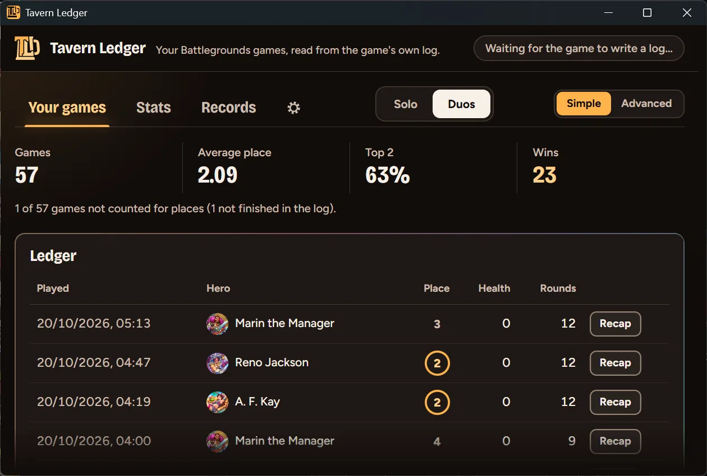
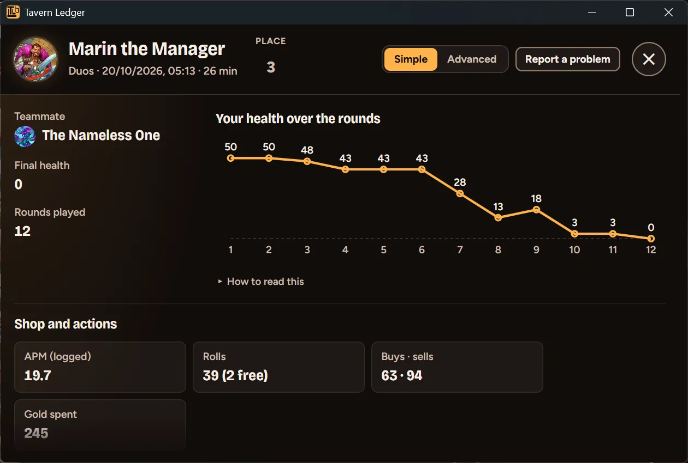
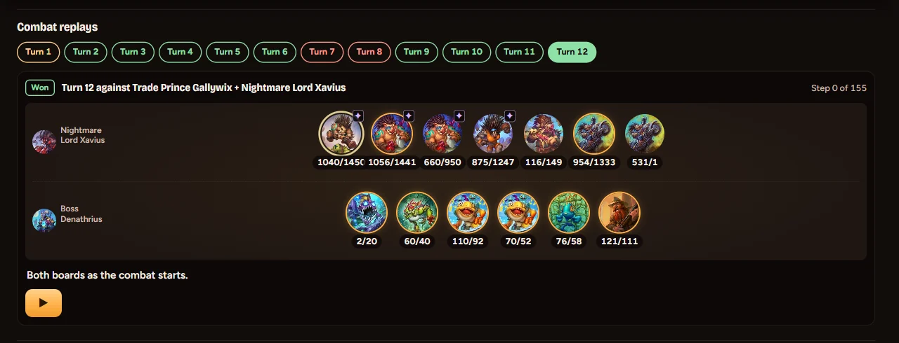
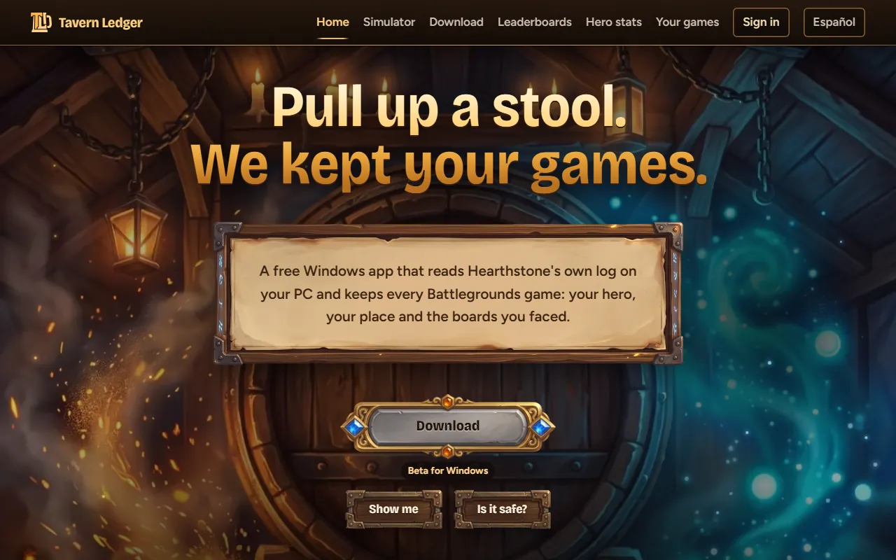
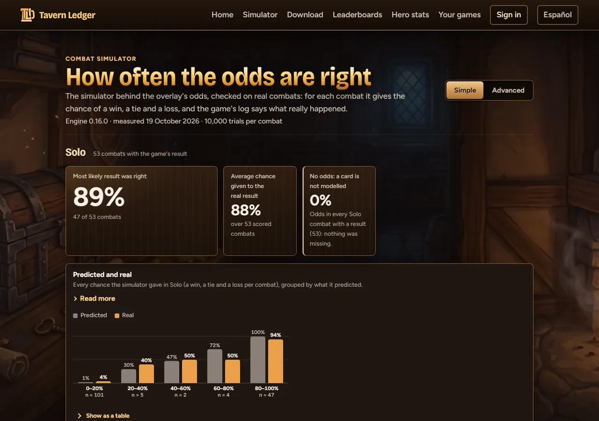

  

<h1 align="center">Tavern Ledger</h1>

  A free, open-source Hearthstone Battlegrounds tracker for Windows, with a website to follow your progress. 
  Review every game, replay its combats, keep an overlay beside the board. Solo and Duos. Your games stay on your PC.

  <a href="https://tavernledger.net">tavernledger.net</a> ·
  <a href="#status">Status</a> ·
  <a href="#features">Features</a> ·
  <a href="#privacy-and-your-account">Privacy</a> ·
  <a href="CONTRIBUTING.md">Contributing</a>

> Unofficial fan project. Not affiliated with or endorsed by Blizzard Entertainment.

## Status

- **Desktop app: in beta for Windows.** The current release, [v0.2.4](https://github.com/KBroneZ/tavern-ledger/releases/tag/v0.2.4), is an unsigned installer for beta testers (Windows warns before it runs; the steps are on the [download page](https://tavernledger.net/download/)). From v0.2.1 on, the app updates itself from the project's signed GitHub releases, and only when you press "Restart now"; if you have v0.1.0, install v0.2.4 over it once (your games and settings stay). To build the app or its installer yourself, see [docs/development.md](docs/development.md).
- **Website: online at [tavernledger.net](https://tavernledger.net), and you can create an account.** Uploading games needs the desktop app; the combat simulator and its accuracy page work without one.

## Features

### Desktop app (Windows)

- **Every Battlegrounds game kept**, read from the game's own log as it is played: hero, Duos teammate, place, health each round, the opponents you met and both boards at each combat.
- **A recap of each game**: your health over the rounds, the shop turn by turn (rolls, buys, sells, gold, tier-ups, logged actions per minute), the heroes you were offered, the trinkets, Dark Gifts and discovers you took, and your record against each opponent.
- **Combat replays**, attack by attack, from the log: what the game played on your screen, never a simulation.
- **Stats** for Solo and Duos apart: totals, every hero you played, tribes, trinkets and Dark Gifts with their pick rates, plus a Records tab.
- **An in-game overlay**, if you want one: hover a hero on the game's leaderboard to see the last board you met from them, with tier, health, triples and your record; the next opponent is marked.
- **Combat odds** in the overlay, from the project's own simulator: during each combat, the chance to win, tie or lose from the two boards that entered play, in Solo and Duos. A hint, not a promise; the website shows [how often it is right](https://tavernledger.net/accuracy/).
- **Every value says where it comes from**: from the log, inferred, entered by you or unknown. When the app cannot tell, it says so instead of guessing.
- English and Spanish.

### Website

- **Upload your games** from the app, only once you sign in and turn it on.
- **Your dashboard** with your numbers per mode, a filterable games list and a full view of each game, combat replays included.
- **Public profile, leaderboards and community hero stats**, each one opt-in and off until you turn it on. Leaderboards show display names and numbers from uploaded games, never ratings or BattleTags.
- **[Combat simulator](https://tavernledger.net/simulator/)** in your browser: load a fight from one of your games (signed in) or set up both boards yourself and see the odds.
- English and Spanish.

Screenshots are from the app and the live website, on the developer's own games. Card art © Blizzard Entertainment, from [HearthstoneJSON](https://hearthstonejson.com/).

## Privacy and your account

- **Your games stay on your PC.** Nothing is uploaded unless you sign in and turn uploading on.
- **No other players' names.** The app keeps opponents by hero, never by name or BattleTag.
- **What the app does with the game:** it reads the game's log files and, for the overlay, where your pointer is over the game window. By default (you can turn it off in Settings) it also reads two values the game already shows you, the lobby's five tribes and your own Battlegrounds rating, read-only from the game's memory; they stay on your PC and are never uploaded. Reading the game's memory goes against the letter of Blizzard's EULA (section 1.C) and is not approved by Blizzard, so the account at risk is yours; the [terms](https://tavernledger.net/terms/) and the app's Settings explain it.
- **What it never does:** no injection, no changes to the game itself, nothing played or clicked for you. The one thing it writes in the game's folders is Hearthstone's two logging settings files (`log.config` and `client.config`), and only when you click Fix in its setup notice; it keeps a `.bak` copy of any file it changes.
- **The website** keeps accounts and games on servers in the EU (Supabase, Frankfurt), has no analytics and lets you download all your data or delete your account at any time. On a free account, each game's full file (turn-by-turn boards, shops, combat replays) is kept on the server for 28 days from the day it was played; its summary stays in your stats, and the app keeps every game in full on your PC. Your uploaded games are used to improve the combat simulator only if you turn that on (off by default), and only as totals over many games, never per player. Details: [privacy policy](https://tavernledger.net/privacy/) and [terms](https://tavernledger.net/terms/).

## How it is built

A Rust workspace (log parser, tracker, combat simulator and a [Tauri 2](https://tauri.app/) desktop app), a static [Astro](https://astro.build/) website and a [Supabase](https://supabase.com/) backend in Frankfurt, with Python tools for checks and research. The origin and license of every dependency is in [PROVENANCE.md](PROVENANCE.md).

Tavern Ledger is made by one developer with help from AI coding tools.

More reading: [development guide](docs/development.md).

## Contributing and security

Contributions are welcome under the project's license: read [CONTRIBUTING.md](CONTRIBUTING.md) first. To report a security problem privately, see [SECURITY.md](SECURITY.md).

## License

GNU Affero General Public License, version 3 only (`AGPL-3.0-only`). See [LICENSE](LICENSE). You can use, study, change and share the code; if you share a changed version, or run it for others over a network, you share its source under the same license.

Versions published before 12 October 2026 were released under the MIT license and stay available under it.

Hearthstone's names, cards and art belong to Blizzard Entertainment and are not covered by this license.
